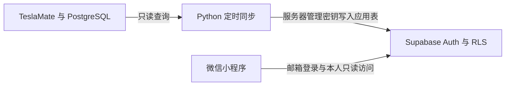

# 这只喵又出发了 · TeslaMate 微信小程序

基于 TeslaMate 的个人车辆只读微信小程序，提供爱车状态、行程详情、月度统计和全部／按月／按日足迹。以个人版 v1.0 为基础整理，使用每位部署者自己的服务器、Supabase 项目和微信小程序账号。



[从零部署教程](docs/部署指南.md) · [GitHub 发布与后续同步](docs/GitHub发布指南.md) · [验证记录](docs/验证记录.md) · [第三方声明](THIRD_PARTY.md)

## 功能与适用范围

- 爱车：电量、额定续航、采集状态、最近充电、最近用车及近30天样本估算续航。
- 行程：最近30次已结束行程、月度统计、详情概况和真实分段轨迹。
- 足迹：全部、按月、按日；按北京时间开始日归属，不跨缺失轨迹连线。
- 权限：匿名无业务读取权限，登录用户只能读取归属于本人的应用记录，客户端无业务写权限。
- 不包含车辆控制或唤醒调用；邮箱密码登录由 Supabase Auth 提供，不使用微信身份登录。

默认面向一个家庭／车主：同一个 TeslaMate 源库中的所有车辆都会同步到配置的一个 `owner_id`。前端首页展示第一辆车，其余页面沿用 v1.0 行为。不要直接将共享源库用于不同车主的多租户服务；RLS 只限制目的库读取，不能替代源库的车辆归属映射。

能耗和可行驶距离包含估算值，缺值不补零。原生地图使用腾讯底图；可选高德服务只解析端点地址。开启高德模块会向高德发送端点坐标，并为 TeslaMate 源库补写缺失地址及关联，不属于只读同步链路。

## 快速开始

1. 按[部署教程](docs/部署指南.md)部署 TeslaMate、配置 Supabase，执行 `backend/001`、`002`、`003` 三个迁移。
2. 在 ECS 上交互创建私有配置，运行 `ops/install_sync.sh` 安装首次同步服务。
3. 本机执行 `python3 tools/configure.py client`，生成被 Git 忽略的客户端配置。
4. 微信开发者工具导入 `miniprogram/`，将 `project.config.json` 的 `touristappid` 改为自己的 AppID。
5. 配置合法 HTTPS request 域名并完成预览、手机验收、审核发布。

服务器路径采用 `/opt/teslamate` 与 `/opt/teslamate-app`，首次安装脚本拒绝覆盖已有安装。运行服务需要 Linux、Docker Compose v2、Python 3.9+、systemd；离线测试使用 Node.js 24 和 Python 3。运行后端无需第三方 Python 包。

当前实现使用 legacy `anon` / `service_role` JWT keys。新的 `sb_publishable_` / `sb_secret_` 格式尚未适配，不可直接替换。管理密钥仅存服务器私有配置，不能放入小程序。

## 本地检查

```bash
node --test tests/*.test.js
python3 -m unittest discover -s tests -p 'test_*.py'
python3 tools/audit_public.py
bash -n ops/bootstrap.sh ops/install_sync.sh
```

可选的本地临时 PostgreSQL 权限验证：

```bash
python3 tools/verify_sql.py
```

该验证只使用合成记录，不连接真实云端。GitHub Actions 另含 Compose 配置检查；当前副本尚未在新的云环境完整部署，也未完成新的微信开发者工具／真机构建验收。已完成检查与剩余项见[验证记录](docs/验证记录.md)。

## 许可证

本项目原创代码与生成素材采用 [MIT](LICENSE) 许可。第三方坐标转换代码保留独立 MIT 声明。TeslaMate 独立安装，不随本仓库分发；本项目不是 Tesla、微信、阿里云或 Supabase 的官方产品。
